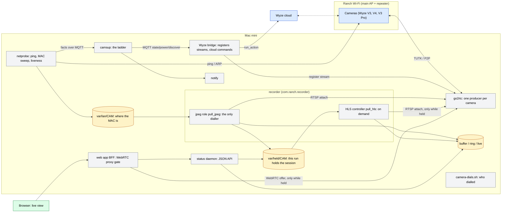
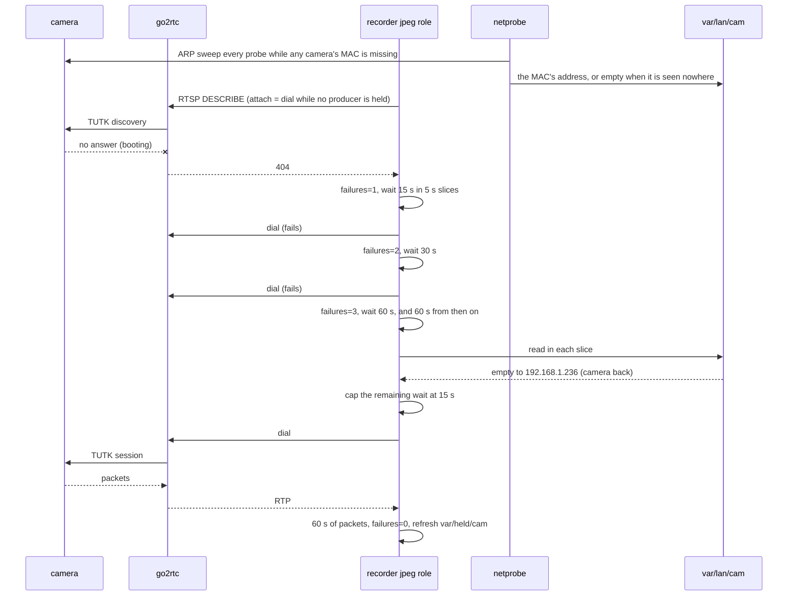
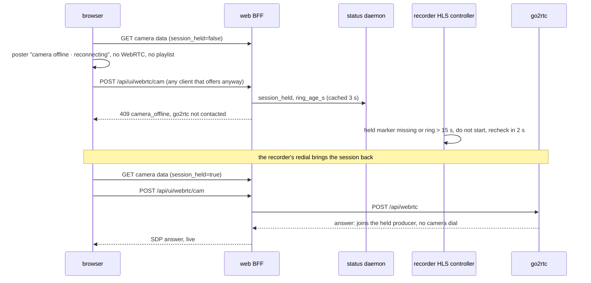
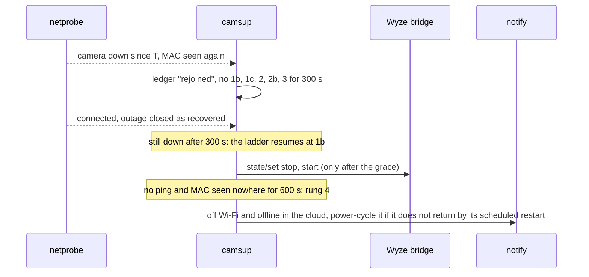
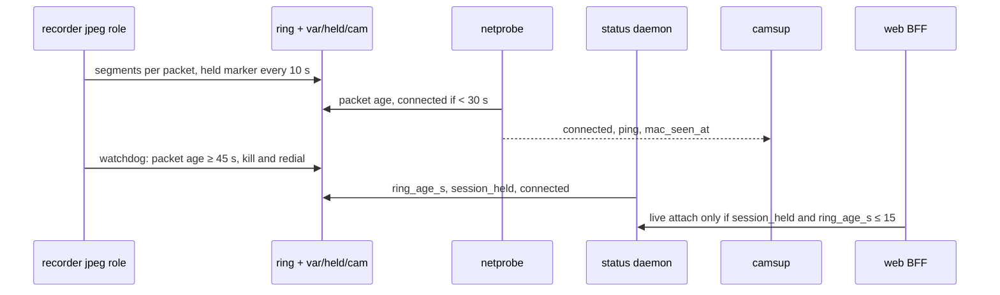

# Camera architecture: one producer per camera, a recorder that keeps up, everything else reads disk

Exactly one go2rtc producer holds each camera, and one always-on recorder process per camera is its steady consumer.
Only that recorder ever causes a camera dial. Every other part of the system reads what the recorder writes to disk, or
joins the session the recorder holds, and never causes a camera connection. The local path (TUTK over the LAN) is
preferred; the bridge's WebRTC fallback stays available.

## Requirements (MUST)

Each requirement names its threshold and the check that fails when it breaks. Changing a threshold means changing this
table, the config key and the check together.

| id | requirement | threshold | checked by |
|---|---|---|---|
| NFR-1 single dialler | Only the recorder's jpeg role causes a camera dial. HLS and WebRTC attach only while that role holds the producer. Supervisor stream re-registrations are the one deliberate exception and obey NFR-8. | 0 dials attributed to HLS, WebRTC or nothing | `camera-dials.sh --assert` (run by `make verify-live`); Playwright offline-camera test |
| NFR-2 single consumer | Nothing but the recorder (jpeg role + on-demand HLS) and browser WebRTC viewers consumes a go2rtc stream. go2rtc's API and RTSP listen on loopback only; WebRTC media is tailnet-only. | ≤ 2 recorder consumers per stream; 0 non-recorder `:8554` clients; 0 non-loopback peers on 1984/8554 | `make camera-owners` (fatal under `make verify`) |
| NFR-3 redial schedule | After any drop (exit, failed dial, watchdog kill) the first redial comes within 15 s; consecutive failures wait 30 s, then 60 s, and stay at 60 s. A run resets the schedule only after 60 s of packets. | first redial ≤ 15 s; ≤ 1 dial per minute per camera after two failures | `reconnect in` log lines; `make camera-dials`; `make e2e-chaos` |
| NFR-4 reappearance | A camera returning to the LAN is seen and redialled quickly. | MAC seen ≤ 15 s (a sweep every probe while any MAC is missing); redial ≤ 15 s after that | netprobe `address back` against the recorder's next `start (jpeg)` |
| NFR-5 recovery | From the moment a camera can stream again, its video is on disk and its status says so. | video on disk ≤ 60 s (≤ 30 s typical); `connected` ≤ 15 s after the first packets | recorder and netprobe logs at a fleet restart; `make e2e-chaos` recovery ≤ 120 s |
| NFR-6 stall detection | A feed that stops while the camera stays on the LAN is detected and re-attached without a person. | not connected ≤ 45 s (`RANCH_FRESH_S` 30 + one 15 s probe); watchdog kill after 45 s without packets | `make e2e-chaos` (≤ 60 s detection, ≤ 90 s watchdog) |
| NFR-7 real time | The recorder keeps real time: one JPEG per keyframe, no padded output; the newest buffer picture is no older than the camera's keyframe interval. | picture age ≤ keyframe interval; recorder ffmpeg CPU ≤ 10 % each | the burned-in-clock check (Operating it); `make verify-live` CPU line |
| NFR-8 supervisor restraint | The supervisor leaves a reappearing camera alone and caps its own impact. | no 1b/1c/2/2b/3 within 300 s of a reappearance; reboots ≤ 1 per camera per 30 min and ≤ 2 per 5 min fleet-wide; go2rtc restart ≤ 1 per hour | ladder unit tests; the ledger's `rejoined` notes |
| NFR-9 liveness truth | Liveness is ring packet age, by one rule wherever it is needed: netprobe (for camsup), the status API (dashboard, WebRTC gate), the recorder watchdog. A file's existence or a JPEG's age never stands in for it. | `connected` ⇔ packet age < 30 s; live attach ⇔ `session_held` and packet age ≤ 15 s | contract test (`ring_age_s` for every camera); `make verify-live` ring soak |
| NFR-10 viewer safety | Opening, leaving or reloading a camera page never causes a camera dial; an offline camera reads as offline. | a WebRTC offer without a held session → 409 `camera_offline`, go2rtc not contacted | BFF unit test; Playwright offline-camera test |
| NFR-11 observability | Every dial and every supervisor action is attributable after the fact. | every dial maps to a trigger within its window; every action has a ledger row with its outcome | `make camera-dials`; `/api/remediation` |

Config keys behind the thresholds: `RECORDER_STALL_S` (45), `LIVE_ATTACH_MAX_RING_S` (15), `REDIAL_OK_S` (60),
`RANCH_FRESH_S` (30), `netprobe_sweep_every`, `camsup_rejoin_grace_s` (300), `camsup_reboot_*`, `camsup_fleet_*`.
No availability target is set: per-camera availability is measured and reported (`/api/availability`), and a target
needs a baseline from a fleet that meets NFR-1 to NFR-9.

## How it works

- **go2rtc** is the Wyze client: a native `wyze://` TUTK source per camera, registered by the Wyze bridge. It holds
  one session (producer) per camera and multiplexes it to every consumer. A consumer that attaches while no producer
  is held makes go2rtc dial the camera: that attach is a dial. Its API (1984) and RTSP (8554) listen on 127.0.0.1
  only; its WebRTC media port (8889) accepts Tailscale clients only.
- **The recorder** (`com.ranch.recorder`, `infra/bin/recorder.sh`) runs one always-on ffmpeg per camera reading
  go2rtc's local RTSP, with two outputs:
  - the **JPEG buffer**: keyframes only are decoded, one JPEG per keyframe (`-fps_mode passthrough`), named by UTC
    second, written atomically (temp file + rename), kept `recorder_buffer_min` minutes;
  - the **ring**: a stream copy of the H.264 into one-GOP MPEG-TS segments, kept 3 minutes, from which ingest cuts
    motion clips (`docs/CLIPS.md`).

  While its run delivers packets, it refreshes `var/held/<cam>` every 10 s and removes it the moment the run ends; the
  recorder clears all markers when it starts. A second, on-demand ffmpeg transcodes HLS for the live view's fallback,
  only while a viewer's `.demand` marker is fresh **and** the session is held.
- **Disk readers.** The sampler (`apps/ingest`) reads the newest buffer JPEG per camera and cuts clips from the ring;
  the detector reads sampled frames; the status daemon serves thumbnails and status. Readers load a JPEG into memory
  before decoding it (`apps/status/src/jpeg.ts`) and never memory-map a file that may still be growing.
- **Live view** (`apps/web`): WebRTC/WHEP straight from go2rtc (signalling proxied by the web app on loopback,
  media on the tailnet), with the on-demand HLS as fallback. A viewer joins the producer the recorder holds. While
  the session is not held, the player attaches nothing and shows "camera offline · reconnecting", and the web app
  refuses any WebRTC offer with 409 `camera_offline` without contacting go2rtc.

Two measures of a camera, used for different questions:

| measure | source | answers |
|---|---|---|
| packet age | newest ring segment's mtime (the stream copy writes every packet) | is video arriving? Liveness: `connected`, the recorder watchdog, the soak, the clips indicator |
| picture age | newest buffer JPEG (one per keyframe) | how old is the newest picture? Thumbnails, the sampler |
| session held | `var/held/<cam>` fresh and packet age ≤ 15 s | may a viewer attach without dialling the camera? |

## Dial discipline

Every path that can attach a camera has a rule, so a camera that is down or still booting is not hammered.

**The recorder's redial (NFR-3, NFR-4).** After a drop the jpeg role waits 15 s, then 30 s, then 60 s for as long as
dials fail. It waits in 5 s slices and reads `var/lan/<cam>`, which netprobe writes every probe: when that file goes
from empty (the camera's MAC is seen nowhere) to an address, the remaining wait drops to 15 s. While any camera's MAC
is missing, netprobe sweeps the /24 on every probe instead of every 20, so a returning camera is in the file within
one probe.

**Live viewers (NFR-1, NFR-10).** A viewer attaches only while the session is held. The HLS controller checks the
held marker and the ring before it starts an encoder, and backs off a start that writes no segment (15 / 30 / 60 s).
The web app checks `session_held` and `ring_age_s` from the status API (cached 3 s) before it forwards a WebRTC offer.

**The supervisor (NFR-8).** When a camera reappears (its MAC is seen again, or it answers ping again) the supervisor
writes a `rejoined` note and takes no stream restart, reboot or go2rtc restart for that camera for 300 s. A camera
that just came back is booting, and the recorder redials it within 15 s.

**Liveness (NFR-9).** One rule, read where it is needed:

## Why

**A camera session must be held, not churned.** go2rtc dials a camera when its first consumer attaches and tears the
session down when the consumer count reaches zero. Each dial is a full TUTK P2P and DTLS handshake. Without one
steady consumer, healthy cameras showed about 10 producer starts a day and the weak ones up to 2,912 (`mops_cam`),
1,585 (`back_pasture_cam`) and 430 (`front_porch_cam`), and that churn knocked the weak cameras off Wi-Fi while the
mini's own Wi-Fi stayed steady. Upstream reports the same failure with V3 Pro cameras behind the bridge:
[docker-wyze-bridge #733](https://github.com/mrlt8/docker-wyze-bridge/issues/733),
[#1240](https://github.com/mrlt8/docker-wyze-bridge/issues/1240),
[#1544](https://github.com/mrlt8/docker-wyze-bridge/issues/1544).

**A waking camera must not be hammered, and only one path may dial.** A camera coming back takes from about a minute
(46–91 s after a cloud restart, measured on all seven) to about 4 minutes (227 s for an unplanned drop on `mops_cam`,
from the stream stopping to the session back); the supervisor's 300 s grace covers the slow case. After a power cycle,
waking cameras were dialled by
three paths at once:
- the recorder's old schedule (2, 5 and 10 s);
- supervisor stream restarts, two per camera, because the ladder counted from the start of a long outage;
- the HLS fallback of an open camera page, which restarted its encoder every ~7 s while no session was held. That was
  69 failed dials at `mops_cam` in 20 minutes, peaking at 9 a minute; 61 of them were caused by the HLS controller.

A viewer was meant to join the recorder's session, but with no session held its attach was itself a dial. Ring
freshness alone is not proof of a held session either. Right after a recorder restart, its HLS encoder attached on
segments the previous instance wrote seconds earlier, and dialled. Hence the held marker. `mops_cam` stayed off Wi-Fi
after its scheduled restart, the cloud answered `3019 device is offline` to a reboot, and only a power cycle brought it
back. Signal and capacity were ruled out: the camera is 2 m from its repeater, and the repeater's stats were normal.

**The consumer must keep up with real time.** go2rtc's RTSP server gives a reading client a 60 s read deadline, and
ffmpeg sends its keepalive (OPTIONS; go2rtc advertises no GET_PARAMETER, `Session: …;timeout=60`) only after it has
read a packet. A recorder that falls behind stops reading, goes silent, and go2rtc drops it with
`[rtsp] handle error="read tcp …: i/o timeout"`, then stops the producer because no consumer is left. On the wire: a
handshake ending at hh:11:29, nothing more from ffmpeg, the drop at hh:12:30.

**One JPEG per keyframe, not per frame.** image2 is a constant-frame-rate output: without `-fps_mode passthrough`
ffmpeg padded each decoded keyframe to the stream's 20 fps and encoded every copy as a 2560×1440 JPEG. A 62 s replay
with the recorder's arguments decoded 33 keyframes and wrote 117 JPEGs (`dup_frames=84`); with passthrough, 33 and 0.
One such pipeline peaked at 24.8 encodes per second (`speed=1.24x`), so seven at once ran below real time. The
cameras' burned-in clocks showed buffer frames 1.5 to 55 minutes behind and growing while the live view was on time,
load average 61–84 on 8 cores, about 45 % CPU per recorder ffmpeg. With passthrough, over an hour: the same clocks
within a keyframe interval of real time at every reading, load average 1.4–2.0, 2–4 % CPU per ffmpeg, and no go2rtc
read-deadline drop, camera dial, watchdog kill or supervisor row.

**Freshness means new content, not a new file.** The padded output wrote a file every second whatever its content, so
every check that read a file's time (watchdog, probe, dashboard tiles) reported cameras live whose pictures were an
hour old. Keyframe intervals differ per camera: 2 s on most, 34–52 s on some (a 51.6 s ring segment on `tractor_cam`
with packets flowing throughout). So liveness reads the ring's packet age, and a stale-picture check never stands in
for it.

**A remedy that kills the only consumer re-dials the camera.** A supervisor rung that restarted the recorder's ffmpeg
whenever go2rtc listed no consumer for it fired about 2,600 times a day, and each kill dropped the consumer count to
zero, so go2rtc dropped and re-dialled the camera: 537 producer starts in 6 h against 38 before. The ladder has no such
rung; the recorder's own watchdog restarts only an ffmpeg that receives no packets.

**On-demand HLS.** Re-encoding seven 1440p streams at once saturated the M2's single video-encode engine: each
encoder's queue grew without bound and the live picture ran minutes behind. One encoder runs while someone watches
over HLS; normally none, since WebRTC needs no transcode.

**Atomic writes and read-into-memory.** A reader that memory-mapped a JPEG while ffmpeg was still writing it touched
pages past the end of the file and the status daemon died with SIGBUS (16 crash reports, all in libvips' JPEG
reader). The recorder writes a temp file and renames it; readers read the whole file into a buffer first.

**Loopback only.** Anything that can attach a go2rtc consumer can make it dial a camera. The bridge's own UI opens one
player per camera on load, and go2rtc once listened on every interface. pf refuses 5080, 1984 and 8554 on every
interface but lo0 (`loopback_only_ports`); `make tunnel` reaches them from the laptop.

**Preload is a trial, not the fix.** `go2rtc_preload_cameras` lets go2rtc hold a session with no external consumer;
it is set on `donkey_cam`. The bridge re-registers every stream (DELETE + PUT) when it starts, which drops a preload
consumer until go2rtc restarts, and preload does not cure a hung dial. A recorder that keeps real time holds the
session without it.

## Availability and the supervisor

netprobe samples every camera every 15 s into SQLite `camera_probe` (7 days): `connected` (the ring got packets in
the last `RANCH_FRESH_S`, 30 s), `session_visible` (go2rtc lists a live producer; it lags the truth by up to 90 s and
misses orphaned stream objects, so it is a fallback only), `consumers`, ping, `mac_seen_at`. It logs
`consumers dropped` with the recorder ffmpeg's pid, its socket state, the picture age and the packet age whenever
go2rtc loses a camera's last consumer. The status daemon derives `connected`/`online`, `ring_age_s` and
`session_held` from the same ring and marker and serves `/api/availability`.

The supervisor (`com.ranch.camsup`, `apps/camsup`) reads those facts only, never opens a stream or calls go2rtc,
and writes every decision to SQLite `remediation` with its outcome:

| rung | where | condition | action | limits |
|---|---|---|---|---|
| watchdog | recorder | no ring packets for `RECORDER_STALL_S` (45 s), counted from this ffmpeg's start at the earliest | TERM, 3 s, KILL that ffmpeg; remove the held marker; redial on the 15/30/60 s schedule | every 10 s check |
| 0 | supervisor | not connected | outage row | one per outage |
| rejoined | supervisor | a down camera's MAC is seen again, or it answers ping again | note only; no 1b, 1c, 2, 2b or 3 for this camera for `camsup_rejoin_grace_s` (300 s) | once per reappearance |
| 1b | supervisor | down ≥ `camsup_stream_restart_after_s` (120), answers ping at the address the bridge dials | the bridge counts a configured source as alive and never reconnects a dead producer: stop/start that one stream over MQTT | once per outage |
| 1c | supervisor | go2rtc dials an address the camera's MAC is not at, and the bridge already holds the right one | stop/start that stream | 120 s between tries |
| 2 | supervisor | down ≥ `camsup_reboot_after_s` (600) and reachable for a reboot (answers ping, or its MAC is at another address the cloud does not know) | reboot through the Wyze cloud; a watcher then rediscovers until the bridge has the camera's address, then stop/starts the stream | 1 per camera per 30 min, 2 per 5 min fleet-wide |
| 2b | supervisor | off the LAN ≥ `camsup_blind_reboot_after_s` (3600) | one blind cloud reboot in case it rejoins | once per 6 h per camera |
| 3 | supervisor | ≥ 3 cameras down ≥ 900 s after a reboot each | restart go2rtc (every camera redials once) | 1 per hour |
| 4 | supervisor | down ≥ 600 s, no ping, MAC seen nowhere | alert: off Wi-Fi and offline in the cloud, a reboot cannot reach it, power-cycle it if it does not return by its scheduled restart; `com.ranch.notify` posts it after an hour | once per outage |

Rows other than the outage note are judged `not_recovered` after 10 minutes without recovery; recovery closes every
open row with its duration. `camsup_dry_run` records decisions without acting. The ladder is a pure module with tests
(`apps/camsup/src/ladder.ts`).

## Where a camera really is

The bridge's address for a camera is the Wyze cloud's, the one the camera reported at its last boot. A DHCP re-lease
moves a camera while the cloud keeps the old address, so the bridge and go2rtc dial a dead address until the camera
reboots. netprobe sweeps the cameras' /24 every `netprobe_sweep_every` probes, on every probe while any camera's MAC
is missing, and at once when a session drops. It reads the neighbor table, reports `mac_seen_at` and `address_moved`,
and writes `var/lan/<cam>` for the recorder; rungs 1c and 2 act on it. The bridge re-fetches the cloud list every
`wyze_bridge_refresh_interval` (5 min).

## Notifications

`com.ranch.notify` posts fleet-down (≥ `notify_fleet_min` cameras down ≥ `notify_fleet_after_s`), a single camera
down ≥ `notify_camera_after_s` (for a camera off the LAN: power-cycle it if it does not return by its scheduled
restart), the supervisor's reboots and go2rtc restarts, recoveries, and a daily line at `notify_daily_utc_hour`, to
an ntfy.sh topic named in `~/.config/ranch/notify.env` on the mini (mode 600, never in the repo). Without that file it
logs what it would have posted.

## Proof

`make e2e-chaos [CAM=back_yard_cam] [DURATION=90] [MODE=stop|udp]` (`infra/bin/e2e-chaos.sh`, on the mini, software
only). `stop` SIGSTOPs the camera's recorder ffmpeg, so packets stop at once, the symptom of a hung dial or a dead
feed. It asserts: netprobe reports the camera not connected within 60 s; the watchdog re-attaches within 90 s; the
supervisor writes the outage row; after the fault the camera is connected within 120 s and its ring is fresh;
`camera-owners.sh` passes. A run on `back_yard_cam`, `DURATION=90`: not connected after 32 s, watchdog kill at 54 s,
first redial 15 s after the kill, outage row written, connected again 0 s after the fault, ring fresh, owners OK:
PASS. `udp` drops the camera's UDP in a pf child anchor and reports timings only: the TUTK session relays around a LAN
block after about 40 s, so it does not reproduce a dead session.

**A fleet restart**, emulated by sending the Wyze cloud restart command to all seven cameras at once (MQTT
`wyzebridge/<cam>/power/set restart`, as the nightly scheduled restart does):
- every session dropped within 1 s; each recorder's read timed out 26–33 s later, and its first redial came 15 s after
  that;
- six cameras were back 46–61 s after the command, `mops_cam` among them;
- `back_yard_cam`'s first redial failed (still booting), the next came on the 30 s step, and it was back at 91 s;
- `camera-dials --assert`: 0 violations, one dial per camera (plus that one failed dial), at most one per minute;
- the supervisor wrote one outage row and took no action.

NFR-3, NFR-5 and NFR-8 held.

## Operating it

- `make camera-owners`: every consumer of every stream, and a failure on anything that is not the recorder (also
  fatal under `make verify`). It asserts loopback-only listeners, recorder-only :8554 clients, at most two recorder
  consumers per stream, no non-loopback peer on 1984/8554, and recorder-only writers under the buffer and the ring.
- `make camera-dials [H=1] [CAM=] [ASSERT=1]`: who dialled each camera, per 10 minutes, with the peak dials per minute.
  `ASSERT=1` attributes each dial to the attach that began it (the trigger nearest 5 s before the dial's log line,
  within 16 s; go2rtc logs a dial when it ends) and fails on any dial caused by HLS, WebRTC or nothing.
- `make verify-live [MINUTES=30]`: soak; every connected camera's ring stays fresh, no crash reports, the on-demand
  transcode invariant holds, and `camera-dials --assert` passes over the soak.
- `make logs-of D=recorder`, `D=netprobe`, `D=camsup`: the reasons behind a reconnect (`reconnect in <d> s (failures
  <n>, lan <ip>)`, `back on the LAN`, `viewer waiting, no held session`, `rejoined`).
- **Picture age, by the camera's own clock.** File times can lie; the burned-in clock cannot. Crop the bottom-right
  corner of each camera's newest buffer JPEG and compare it with the mini's clock: within one keyframe interval is
  healthy. The live view's clock against the browser's clock checks go2rtc and the camera the same way.
- The dashboard: Home's camera tiles and `clips 1h` tile, System's network probe, availability, clips pipeline and
  supervisor ledger.
- Config (`infra/ansible/group_vars/ranch.yml`): `ranch_cameras`, `recorder_buffer_min`, `recorder_jpeg_q`,
  `recorder_min_free_gb`, `recorder_live_height`, `recorder_demand_ttl`, `camsup_*`, `netprobe_sweep_every`,
  `notify_*`, `go2rtc_preload_cameras`, `loopback_only_ports`, `tailscale_only_ports`.

## Limits and open questions

- Why `mops_cam` stays off Wi-Fi after a soft restart, until a power cycle, is not known from the mini. The router's
  view (which AP each camera joins after a restart, association and DHCP events) would answer it.
- A recorder restart (a deploy) dials every camera at once; DTLS handshakes then time out on several cameras and the
  15/30 s redials bring them back within about three minutes.
- What tipped the recorder below real time on the day the lag began is not known: the duplicate encoding was older
  than the outages, and nothing was deployed in between. One JPEG per keyframe removes the margin problem whatever
  the trigger.
- Clip rules count keyframes (confirm on 2 of 3, close 8 s after motion). On the cameras with 34–52 s keyframe
  intervals that is coarse: a short walk can fit between two keyframes.
- The recorder runs as the `ranch` user like everything else; a separate uid would let pf accept RTSP on loopback from
  the recorder only.
- go2rtc's `api.allow_paths` is not set; the API's trace log lists the paths in use.
